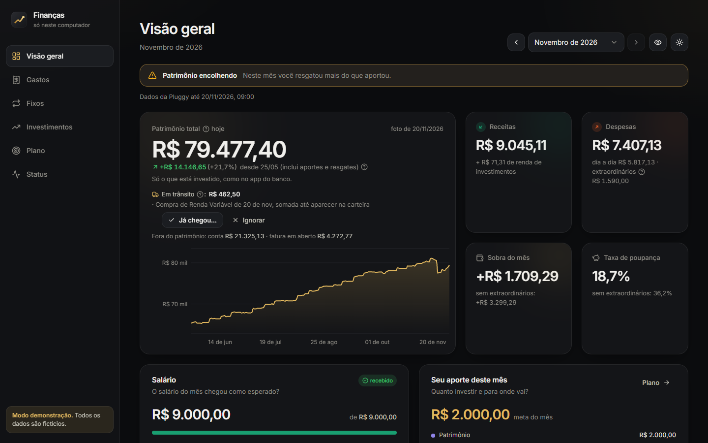
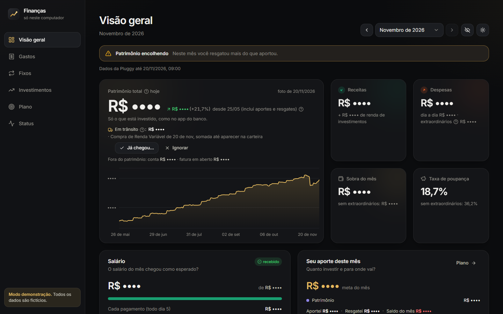
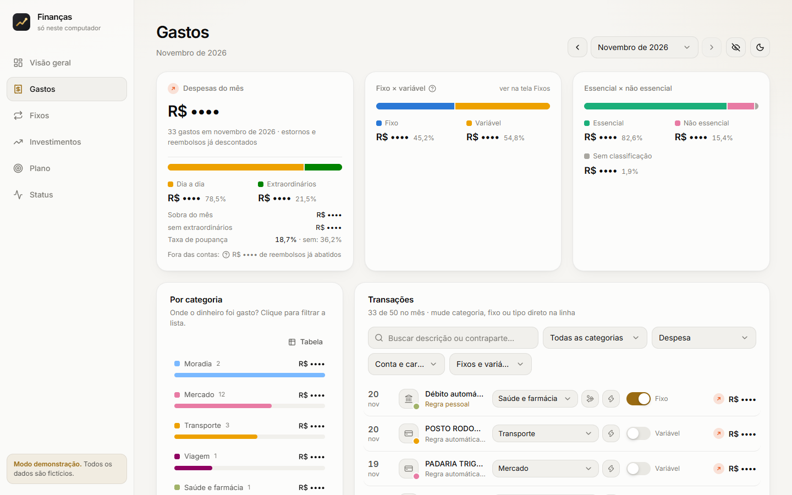
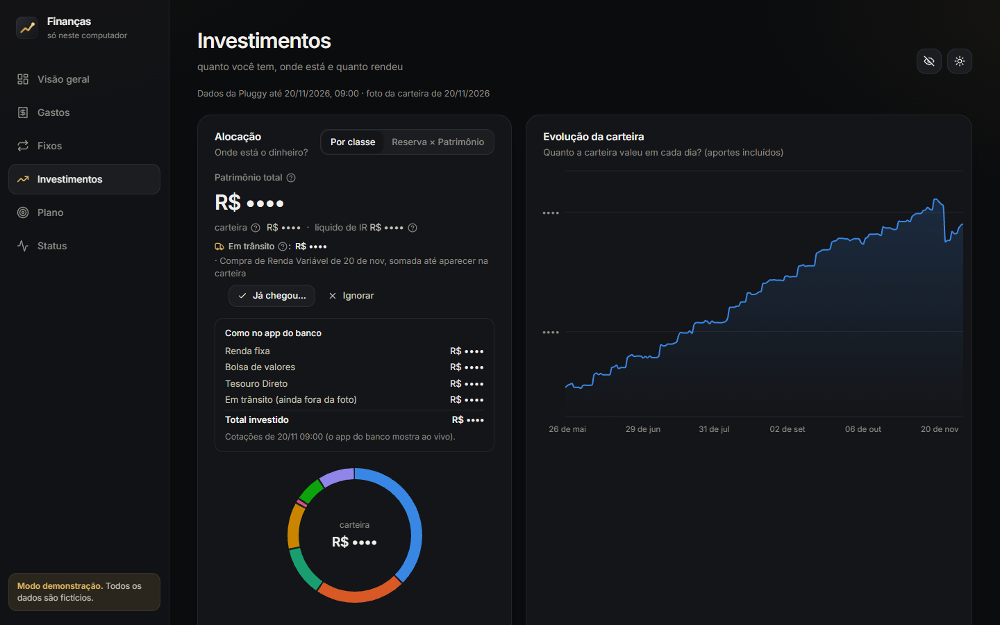
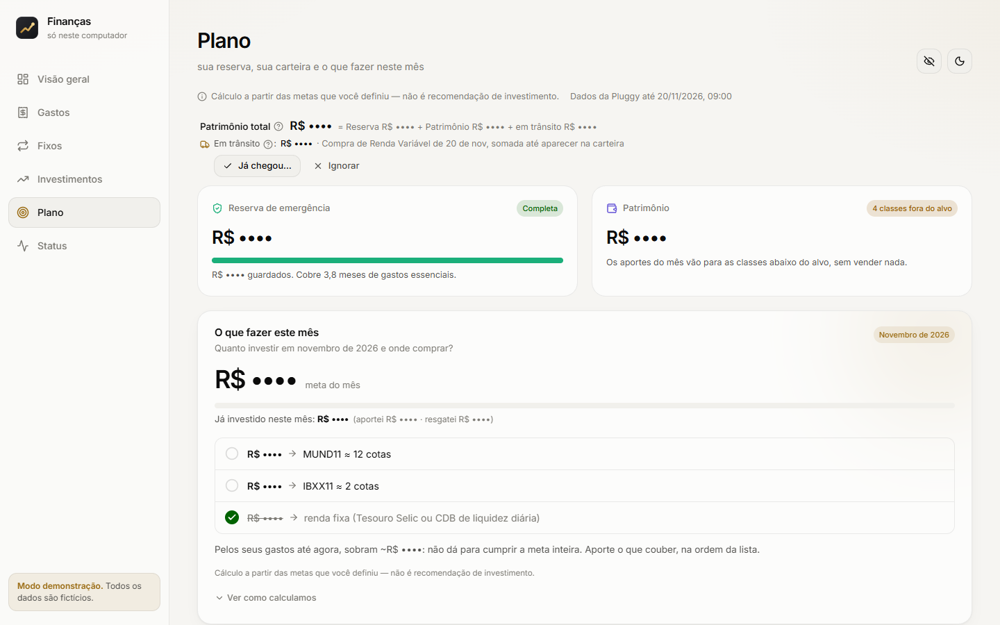

# Open Finance Dashboard

**A personal finance dashboard that runs only on your computer: it reads your accounts through Brazilian Open
Finance, figures out where the money goes and tells you how much to invest this month — no spreadsheets, and
your data never leaves your machine.**

[](https://github.com/FelipeAGCosta/open-finance-dashboard/actions/workflows/ci.yml)
[](LICENSE)


The user interface is in Brazilian Portuguese, since the data source (Open Finance Brasil, through
[Pluggy](https://pluggy.ai)) is Brazil-specific. The full documentation is in Portuguese in [README.md](README.md);
this page is a summary.



**Privacy mode:** the eye button masks every R$ amount as •••• (handy when sharing your screen).



<table>
  <tr>
    <td></td>
    <td></td>
    <td></td>
  </tr>
</table>

## What it does

- **Syncs** checking account, credit card and investments from every connected bank into a local SQLite
  database — the API only keeps 12 months, the local database keeps everything.
- **Classifies** each transaction with layered rules (manual override > personal rules > base rules >
  person-to-person transfers > card MCC > provider category), pairs card bill payments to avoid double
  counting, detects recurring bills and salary (weekly, biweekly or monthly) and links redemptions to the
  asset they came from.
- **Tracks the portfolio**: allocation, daily snapshots, time-weighted return (TWR) and money-weighted return
  (XIRR) against CDI and IPCA (inflation), plus purchases still "in transit" before settlement.
- **Plans the month**: an emergency reserve with a fixed target, a target allocation for the rest, and a
  checklist that splits this month's contribution without selling anything — it ticks itself when the
  purchase shows up in the data.

## Quick start (demo mode, no credentials)

Requires Python 3.12+ and Node.js 22+ (a virtual environment is recommended).

```bash
pip install -e .
npm --prefix frontend ci && npm --prefix frontend run build
findash demo
```

It opens `http://127.0.0.1:8765` with 14 months of **synthetic** data generated from a fixed seed.

## Using your own data

Create a free [Meu Pluggy](https://meu.pluggy.ai) account and connect your banks, create an application in the
[Pluggy dashboard](https://dashboard.pluggy.ai), then fill in `.env` from [.env.example](.env.example) and run
`findash sync` followed by `findash app`. Step by step (in Portuguese): [docs/pluggy-setup.md](docs/pluggy-setup.md).

## Architecture

Pluggy → atomic sync → SQLite → derived classification layer → portfolio and plan → FastAPI (127.0.0.1 only)
→ React. See [docs/architecture.md](docs/architecture.md) and the design decisions in
[docs/decisions.md](docs/decisions.md): integer cents, idempotent and atomic sync, bill pairing, "in transit"
purchases, TWR vs. XIRR and contribution-only rebalancing.

## Privacy

Everything stays local; the server only listens on `127.0.0.1` and rejects non-local `Host`/`Origin`
headers. Pluggy access is read-only. Secrets live only in `.env` and are masked in logs and stored payloads.

## How it was built

Built by me with Claude Code as a coding tool, inside my own AI Engineering Starter Kit workflow: project
profiles, mandatory pre-publish checks (secrets, tests, lint, build) and a versioned project memory that keeps
evidence-backed learnings apart from unconfirmed hypotheses. Details in [docs/ai-workflow.md](docs/ai-workflow.md).

## License

[MIT](LICENSE). Not affiliated with Pluggy, Nubank or any financial institution. Not investment advice.
