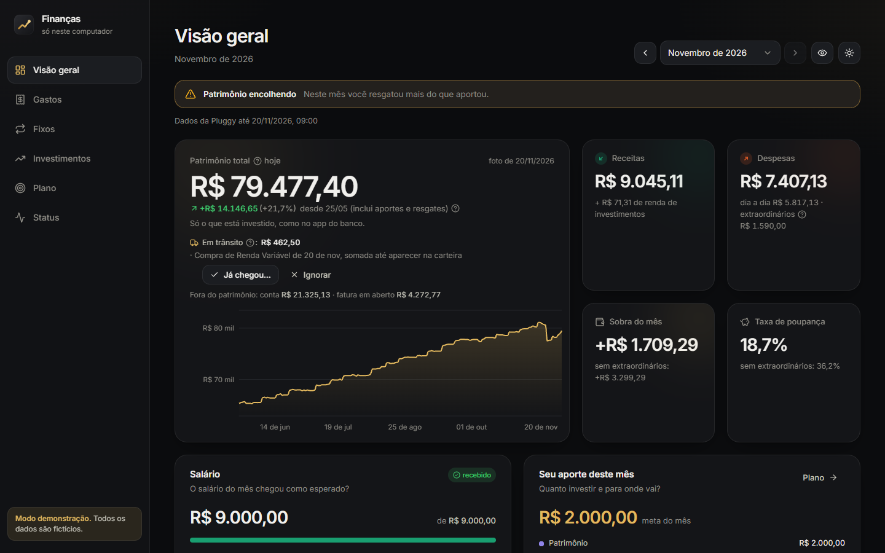
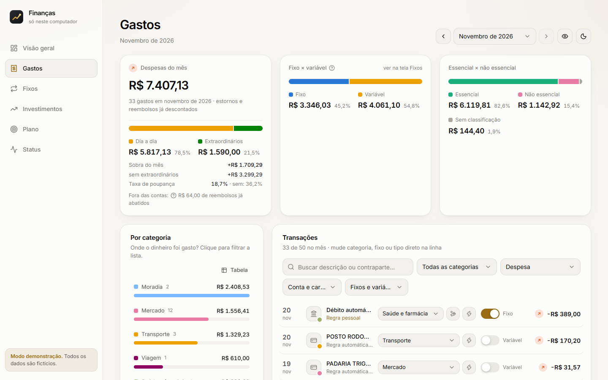
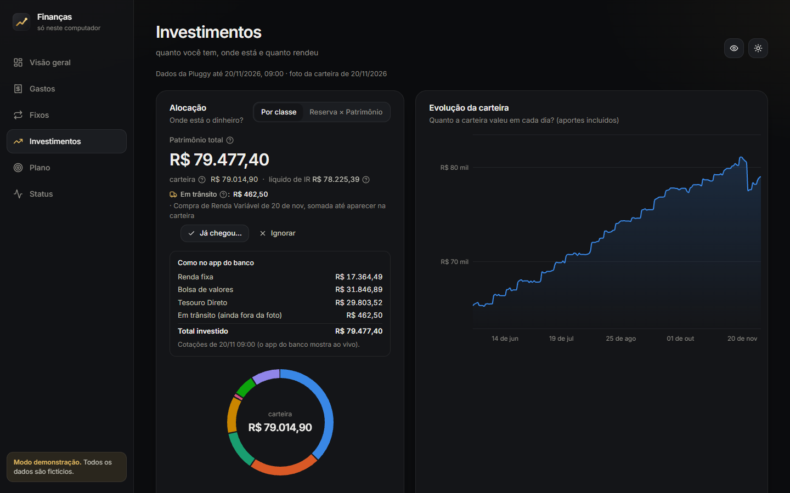
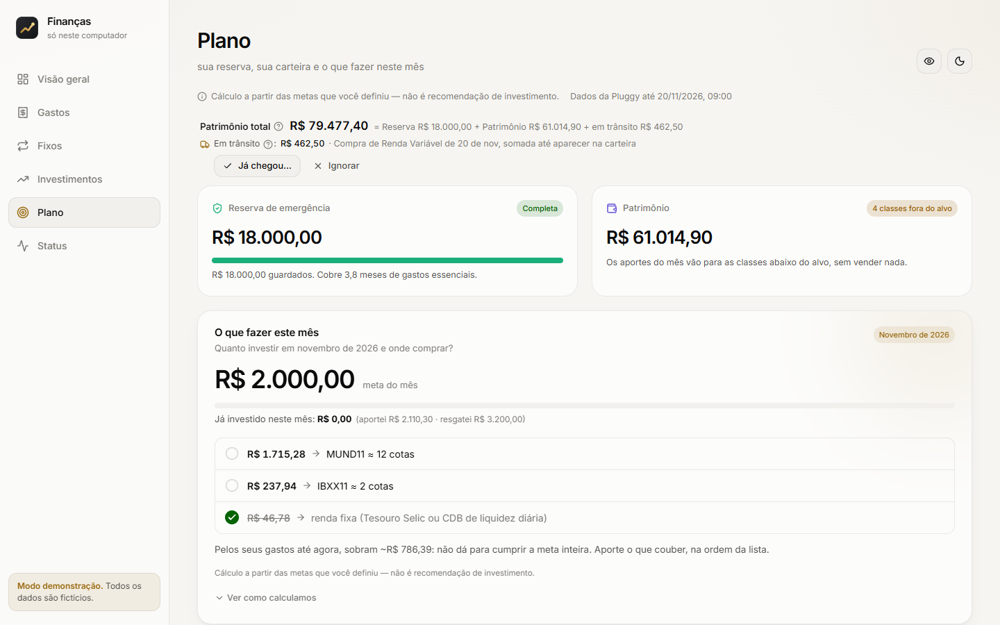
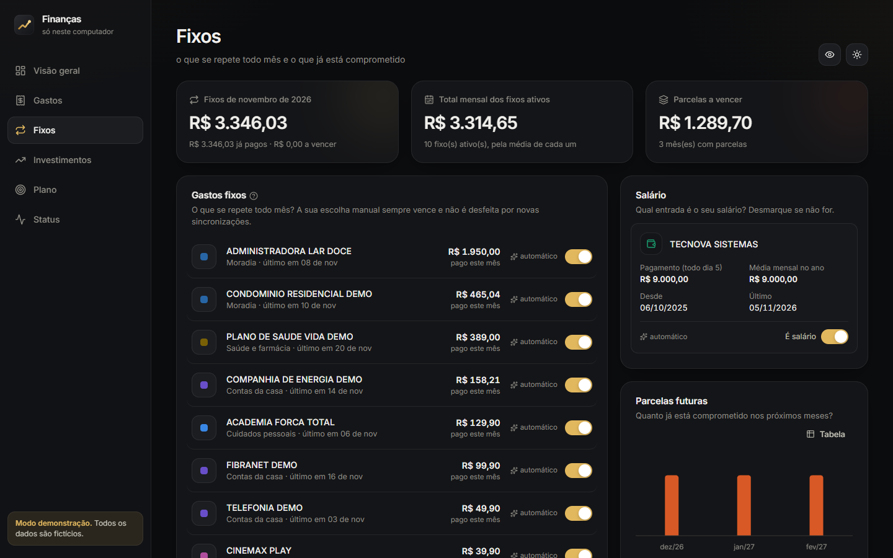
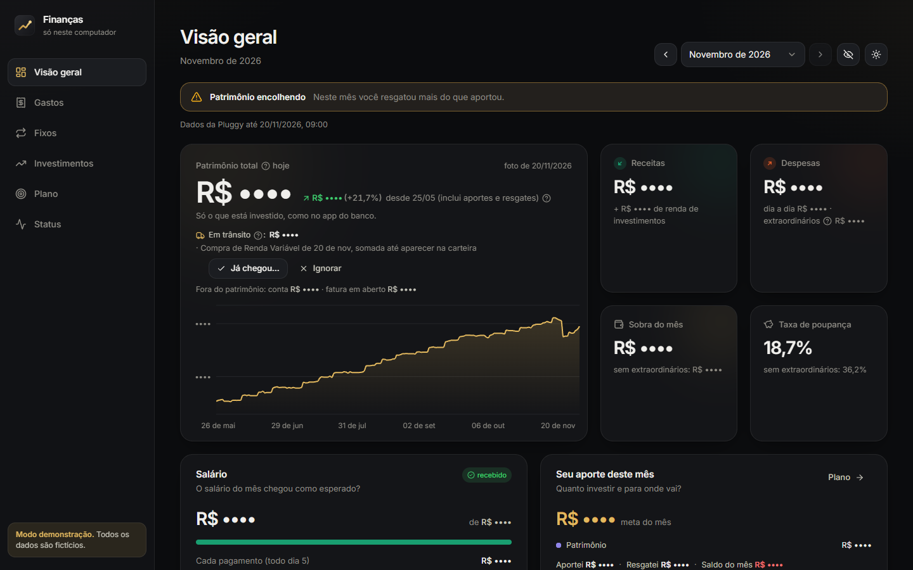
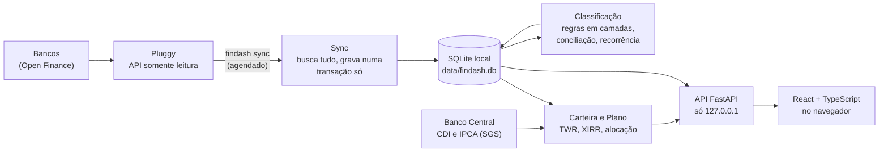

# Open Finance Dashboard

**Um painel financeiro pessoal que roda só no seu computador: lê suas contas pelo Open Finance, entende
para onde vai o dinheiro e diz quanto investir neste mês — sem planilha e sem mandar seus dados para nenhum
servidor.**

[](https://github.com/FelipeAGCosta/open-finance-dashboard/actions/workflows/ci.yml)
[](LICENSE)


> **In English:** a local-first personal finance dashboard for Brazilian Open Finance data (via
> [Pluggy](https://pluggy.ai)). It syncs your bank accounts, credit card and investments into a local SQLite
> database, classifies every transaction with layered rules, tracks portfolio performance (TWR × XIRR against
> CDI and inflation) and suggests how to split this month's contribution without selling anything. Python +
> FastAPI backend, React + TypeScript frontend, 270+ tests. Try it in three commands with synthetic data — see
> [README.en.md](README.en.md).



<table>
  <tr>
    <td></td>
    <td></td>
  </tr>
  <tr>
    <td></td>
    <td></td>
  </tr>
</table>

<sub>Todas as imagens são do modo demonstração: nomes, valores e tickers são inventados.</sub>

**Modo privacidade:** o botão do olho troca todos os valores em R$ por •••• (útil para mostrar a tela a alguém).



## Por que existe

O app do banco mostra o extrato; a planilha exige disciplina para manter. Eu queria responder perguntas
simples com os dados que já existem — *quanto eu gasto de verdade por mês? o que é fixo? meu patrimônio
cresceu porque eu aportei ou porque rendeu? quanto dá para investir agora, e em quê?* — sem digitar nada e
sem entregar o histórico financeiro a mais um serviço na nuvem.

O Open Finance resolve a parte dos dados. Este projeto faz o resto: guarda o histórico localmente (a API
só devolve 12 meses), classifica, concilia e apresenta.

## O que faz

| Tela | O que mostra |
|---|---|
| **Visão geral** | patrimônio total e evolução, receitas × despesas do mês (dia a dia × extraordinários), taxa de poupança, salário esperado × recebido, resumo do aporte do mês e alertas |
| **Gastos** | despesas por categoria, fixo × variável, essencial × não essencial, empréstimos a amigos em aberto e a lista de transações — categoria, fixo, tipo e "extraordinário" mudam na própria linha, para *só esta* ou *toda a contraparte*, sempre com **Desfazer** |
| **Fixos** | contas recorrentes detectadas sozinhas (pagas e a vencer), assinaturas inativas, salário e parcelas futuras |
| **Investimentos** | alocação por classe, rentabilidade **TWR × CDI × IPCA × meta**, rendimento mês a mês, variação por ativo, renda fixa e proventos |
| **Plano** | Reserva de emergência + Patrimônio com alocação-alvo, "o que fazer este mês" (checklist que se marca sozinha quando o aporte aparece) e uma calculadora de juros compostos |
| **Status** | última sincronização, consentimento, dias de foto e "Sincronizar agora" |

Também: tema claro/escuro, botão de olho que esconde todos os valores, PWA instalável e uma CLI com os
mesmos relatórios no terminal (`findash resumo`, `findash carteira`, `findash fixos`...).

## Como funciona



1. **Sync** (`findash sync`, duas vezes por dia pelo agendador): busca contas, transações, investimentos e
   movimentações de cada item da Pluggy e só então grava tudo numa única transação do SQLite. Uma foto diária
   da carteira e dos saldos alimenta a rentabilidade.
2. **Classificação**: uma camada derivada, recalculada do zero a cada sync (idempotente): tipo de movimento,
   categoria, pareamento de fatura, origem de resgates, gastos fixos e salário. O dado bruto nunca é alterado.
3. **API + interface**: o FastAPI monta o JSON de cada tela e serve o frontend compilado; tudo escuta só em
   `127.0.0.1`.

Detalhes em [docs/architecture.md](docs/architecture.md).

### Stack (e por quê)

| | Escolha | Por quê |
|---|---|---|
| Dados | **Pluggy** (Open Finance) | agrega bancos brasileiros com consentimento do titular; o **Meu Pluggy** permite ler os próprios dados |
| Backend | **Python 3.12 + FastAPI** | ótimo para lógica de dados e números (`Decimal`, `statistics`); FastAPI dá validação e tipagem com pouco código |
| Banco | **SQLite + SQLAlchemy 2 + Alembic** | um arquivo local, sem servidor; migrações aplicadas sozinhas no sync e no app |
| Frontend | **React 19 + TypeScript strict + Vite** | tipos compartilhados com a API em `lib/api.ts`; build rápido |
| UI | **Tailwind 4, Radix, Recharts, Motion** | componentes acessíveis e gráficos sem reinventar a roda |
| Qualidade | **pytest, ruff, ESLint, Vitest, GitHub Actions** | os testes usam só dados sintéticos e rodam em todo push |

## Quick start (modo demonstração, sem credenciais)

Pré-requisitos: Python 3.12+ e Node.js 22+. De preferência dentro de um ambiente virtual
(`python -m venv .venv` e ativar).

```bash
pip install -e .
npm --prefix frontend ci && npm --prefix frontend run build
findash demo
```

O navegador abre em `http://127.0.0.1:8765` com 14 meses de dados **sintéticos** gerados com semente fixa.
`findash demo --as-of 2026-11-20` congela a data de referência (é assim que as imagens acima são geradas).

## Conectar seus dados reais

Passo a passo completo em [docs/pluggy-setup.md](docs/pluggy-setup.md). Resumo:

1. **Meu Pluggy** — crie uma conta em [meu.pluggy.ai](https://meu.pluggy.ai) e conecte seus bancos pelo
   Open Finance (você autoriza no app do banco; o acesso é **somente leitura**).
2. **Dashboard da Pluggy** — em [dashboard.pluggy.ai](https://dashboard.pluggy.ai), crie uma aplicação e
   copie o `CLIENT_ID` e o `CLIENT_SECRET`. Conecte o conector **MeuPluggy** à aplicação e copie o **item id**
   de cada conexão.
3. **`.env`** — copie [.env.example](.env.example) para `.env` na raiz e preencha:

   ```dotenv
   PLUGGY_CLIENT_ID=...
   PLUGGY_CLIENT_SECRET=...
   PLUGGY_ITEM_IDS=id-do-item-1:nubank,id-do-item-2
   ```

   Vários bancos? Separe os itens por vírgula. O sufixo `:nubank` escolhe o
   [perfil de instituição](docs/institution-profiles.md); sem sufixo vale o perfil genérico.
4. **Suas preferências** — copie para `data/settings.yaml` só o que for diferente de
   [config/settings.yaml](config/settings.yaml): periodicidade e dia do salário (semanal, quinzenal ou mensal),
   meta de aporte, Reserva e alocação-alvo. Regras de classificação suas (nomes de pessoas, lugares) vão em
   `data/regras_pessoais.yaml` — veja o [exemplo](config/regras_pessoais.example.yaml).
5. **Primeira carga e uso**:

   ```bash
   findash sync      # busca todo o histórico disponível (as próximas leem uma janela de 60 dias)
   findash app       # abre a interface com os seus dados
   ```

### Agendamento

- **Windows** — o Agendador de Tarefas roda o sync às 08:00 e às 20:00 (e assim que possível, se o PC estava
  desligado). Opcionalmente, o servidor sobe sozinho no login:

  ```powershell
  powershell -ExecutionPolicy Bypass -File .\scripts\agendar_sync.ps1          # -Remover para desfazer
  powershell -ExecutionPolicy Bypass -File .\scripts\iniciar_com_windows.ps1   # opcional
  ```

- **Linux/macOS** — uma linha no `crontab -e`:

  ```cron
  0 8,20 * * * cd /caminho/para/open-finance-dashboard && .venv/bin/findash sync >> data/logs/cron.log 2>&1
  ```

## Privacidade e segurança

- **Tudo local.** O banco, os backups e os logs ficam em `data/`, que está no `.gitignore`. O servidor escuta
  só em `127.0.0.1` e recusa requisições cujo `Host` ou `Origin` não seja local (proteção contra DNS
  rebinding e CSRF).
- **Somente leitura.** O cliente da Pluggy faz `POST /auth` e, fora isso, só `GET`. Nada aqui movimenta
  dinheiro.
- **Segredos fora do Git.** Credenciais só no `.env`; o `client_secret` e a `apiKey` são mascarados em
  logs, mensagens de erro e no JSON bruto guardado no banco.
- **O que a Pluggy enxerga:** os dados que você autorizou no Open Finance (contas, transações,
  investimentos), como em qualquer integração com ela. Este projeto não envia nada para outro lugar; a única
  outra chamada externa é a série pública de CDI/IPCA do Banco Central.
- Backup diário automático do banco antes da primeira sincronização do dia (os 7 mais recentes).

## Decisões técnicas interessantes

Versão longa, com alternativas descartadas, em [docs/decisions.md](docs/decisions.md).

- **Dinheiro em centavos inteiros.** Somas exatas em SQL e em Python, sem `0.1 + 0.2`. O valor original da API
  continua guardado no JSON bruto.
- **Sync idempotente e atômico.** Upsert pelo id da Pluggy (rodar duas vezes não duplica nada) e gravação
  numa transação só, depois de buscar tudo: ou o banco fica com o retrato novo inteiro, ou com o anterior.
  Transações pendentes que somem viram "substituída" ou "removida", nunca são apagadas.
- **Pareamento de fatura.** O pagamento da fatura na conta e o crédito no cartão são o mesmo dinheiro; sem
  parear (mesmo valor, até 5 dias de distância), cada compra no cartão contaria duas vezes nas despesas.
- **"Em trânsito".** Uma compra de ação sai da conta hoje e só aparece na carteira em D+2. Nesse intervalo o
  valor soma ao patrimônio, para ele não "cair" sem motivo; o pareamento casa a saída com o aumento de
  posição (ou a escolha manual "Já chegou").
- **Classificação por regras em camadas.** Escolha manual > regras pessoais > regras base > Pix a pessoa
  física > MCC do cartão > categoria da Pluggy > "A classificar". Cada transação mostra *qual* regra decidiu.
- **TWR × XIRR.** O TWR mede os investimentos (neutraliza aportes e resgates; é o que dá para comparar com o
  CDI). O XIRR mede você como investidor (o momento dos aportes importa). Os dois aparecem lado a lado.
- **Rebalanceamento por aporte.** O plano nunca sugere vender: o dinheiro novo vai primeiro para a classe mais
  abaixo do alvo, até as distâncias se igualarem ("water filling"), respeitando Reserva, núcleo e satélite.
- **Perfil de instituição.** O que muda de banco para banco (texto das descrições, produtos mostrados pelo
  líquido de IR, grupos do app) fica atrás de uma interface pequena. O Nubank é o primeiro perfil.

## Estrutura do repositório

```text
backend/findash/     pacote Python
  pluggy/            cliente HTTP somente leitura (retry, backoff, paginação)
  sync/              sincronização atômica, normalização, backup
  db/                modelos SQLAlchemy e migrações Alembic
  classify/          regras, conciliação, recorrência, salário, resumo do mês
  institutions/      perfis de banco (genérico, Nubank)
  invest/            carteira, patrimônio, em trânsito, TWR/XIRR, CDI/IPCA
  plan/              Reserva, alocação-alvo, divisão do aporte, capacidade do mês
  web/               API FastAPI e proteções do servidor local
  demo.py            gerador de dados sintéticos
frontend/            React + TypeScript (Vite)
config/              regras e taxonomia versionadas, settings.yaml genérico
tests/               pytest, só com dados sintéticos
scripts/             agendamento no Windows
docs/                arquitetura, decisões, setup da Pluggy, imagens
```

Comandos de desenvolvimento:

```bash
pip install -e ".[dev]"
pytest                                   # backend
ruff check backend tests && ruff format --check backend tests
npm --prefix frontend run typecheck && npm --prefix frontend run lint && npm --prefix frontend test
npm --prefix frontend run dev            # Vite em :5173 com /api repassado para o backend em :8765
```

## Como este projeto foi construído

Desenvolvi este painel com o **Claude Code** como ferramenta de programação, dentro de um fluxo de trabalho que
eu mesmo montei: o **AI Engineering Starter Kit**. Na prática, isso significa:

- **perfis de projeto** que definem o que o agente pode tocar, como validar e o que exige aprovação humana;
- **checagens obrigatórias antes de publicar** — busca de segredos, testes, lint e build — por um único
  caminho de commit/push que recusa branch protegida e verificação falhando;
- **memória de projeto versionada**, separando *aprendizados* (só com evidência: teste ou commit) de
  *hipóteses* ainda não confirmadas e de *decisões* (que só valem com aprovação explícita).

As decisões de produto, a modelagem financeira e a revisão de cada mudança são minhas; o agente acelera a
implementação e os testes. O fluxo, com exemplos genéricos, está em [docs/ai-workflow.md](docs/ai-workflow.md).

## Roadmap

- [ ] Perfis de instituição para outros bancos (contribuições bem-vindas)
- [ ] Importação de OFX/CSV para quem não usa a Pluggy
- [ ] Orçamento por categoria com alerta de estouro
- [ ] Empacotamento em um executável (sem precisar de Python/Node instalados)

## Contribuindo

Issues e PRs são bem-vindos — veja [CONTRIBUTING.md](CONTRIBUTING.md). Adicionar um banco novo costuma ser só
um perfil de instituição: [docs/institution-profiles.md](docs/institution-profiles.md).

## Licença e avisos

[MIT](LICENSE). Projeto pessoal, **sem afiliação** com a Pluggy, o Nubank ou qualquer outra instituição
financeira; marcas citadas pertencem aos seus donos. Os números do Plano são cálculos a partir das metas que
você define — **não são recomendação de investimento**.
