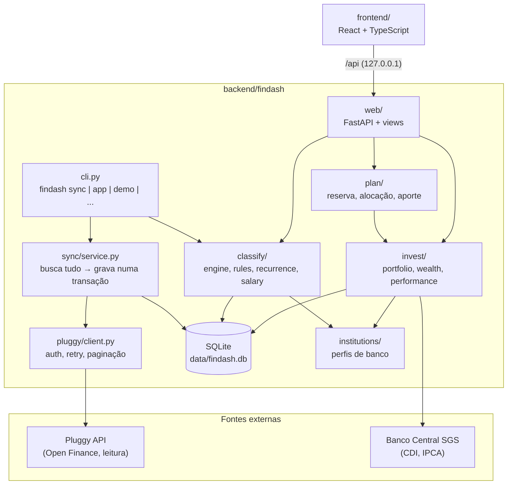

# Arquitetura

O painel é um monólito local pequeno: um pacote Python (`backend/findash`) que sincroniza, classifica e serve
uma API, e uma SPA em React (`frontend/`) que o próprio backend entrega depois de compilada.

## Camadas de dados

O banco tem três tipos de tabela, e a separação é o que deixa tudo recalculável:

| Tipo | Tabelas | Quem escreve | Pode ser recalculada? |
|---|---|---|---|
| **Bruto** (espelho da Pluggy) | `accounts`, `transactions`, `investments`, `investment_transactions`, fotos diárias (`investment_snapshots`, `account_snapshots`), `item_status`, `sync_runs` | só o sync | não: é o histórico (a Pluggy guarda só 12 meses) |
| **Derivado** | `transaction_classifications`, `transaction_links`, `redemption_origins` | a classificação | sim, do zero, a cada `classificar` |
| **Decisões do usuário** | `classification_overrides`, `recurring_rules` (status), `plan_settings`, `investment_places`, escolhas de "em trânsito" | a interface e a CLI | não: são a vontade do usuário e sobrevivem aos recálculos |

Valores monetários são centavos inteiros (`*_cents`); quantidades e preços unitários usam `Numeric`. Datas e
horas são UTC sem fuso no banco; colunas `date` estão no horário de Brasília.

## Fluxo do sync

1. Registra um `sync_run` em andamento (commit próprio, para sobreviver a uma falha).
2. Para cada item de `PLUGGY_ITEM_IDS`: item, contas, transações (janela incremental de 60 dias, ampliada para
   cobrir pendentes abertas), investimentos e suas movimentações.
3. Só depois de buscar tudo, aplica numa transação: upsert pelo id da Pluggy, foto do dia da carteira e dos
   saldos, resolução de pendentes que sumiram (substituída × removida).
4. Fecha o `sync_run` com contagens ou com a mensagem de erro (segredos mascarados) e roda a classificação.

## Classificação

`classify/engine.py` recalcula, para cada transação ativa:

1. **Tipo de movimento**: escolha manual > regra com `tipo` > padrões do perfil da instituição (pagamento de
   fatura, aporte, resgate...) > transferência para o próprio titular > estorno > despesa/receita.
2. **Categoria** das despesas: manual > regras pessoais > regras base > Pix/TED a pessoa física > MCC >
   categoria da Pluggy > "A classificar". Estornos herdam a categoria da compra original.
3. **Vínculos**: fatura na conta ↔ crédito no cartão; estorno → compra; crédito de resgate → ativo de origem
   (pela queda na foto diária ou pela venda registrada).
4. **Recorrência**: gastos fixos e salário. Se os créditos seguem a agenda de `settings.yaml`, a regra guarda o
   valor de cada pagamento e a agenda, e a tela confere esperado × recebido.

## Perfis de instituição

O que é específico de um banco fica em `institutions/` — ver [institution-profiles.md](institution-profiles.md).
O perfil de cada conta e investimento é gravado no sync (coluna `institution`), então a classificação e a
carteira escolhem o perfil certo sem configuração extra, mesmo com vários bancos.

## Servidor local

`web/app.py` cria o FastAPI sem documentação automática, com um middleware que só aceita `Host` e `Origin`
locais (`web/security.py`). Cada tela tem um módulo em `web/views/` que monta o JSON a partir dos pacotes de
domínio; os tipos correspondentes do frontend estão em `frontend/src/lib/api.ts`.

## Frontend

React 19 com TanStack Query para o estado do servidor, roteamento por hash (`#/gastos`) e componentes próprios
sobre Radix e Recharts. Toda ação que muda dados devolve um `undo` que a interface oferece num aviso
("Desfazer").
